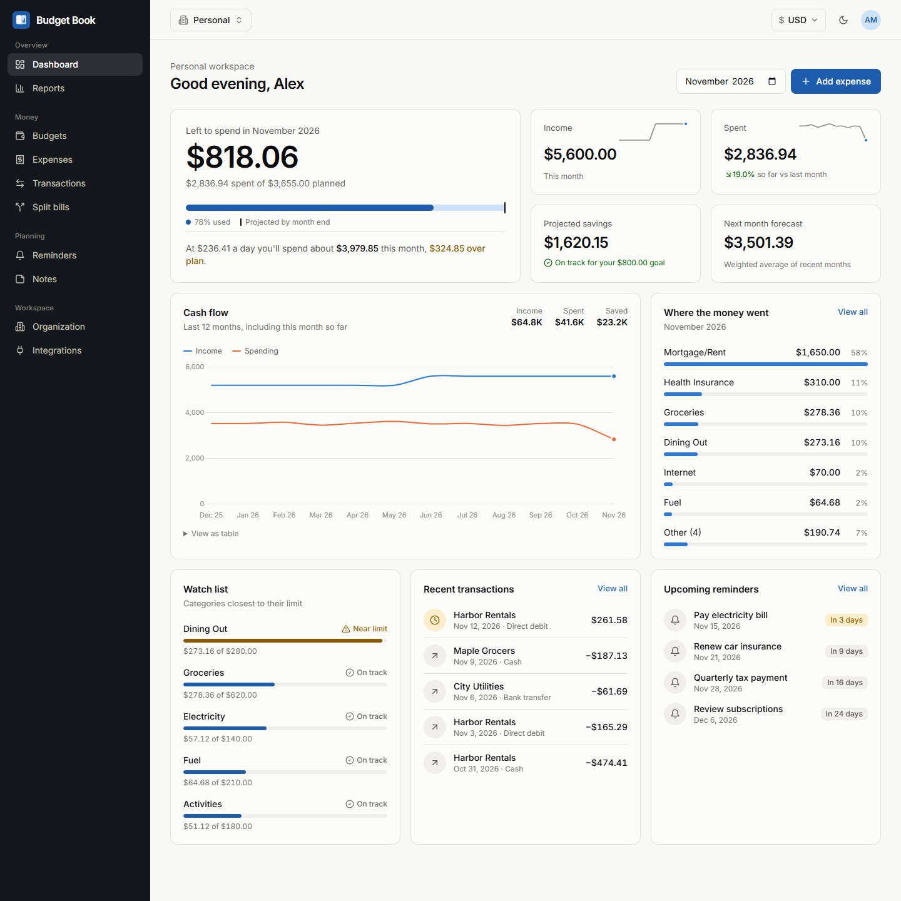

# Budget Book

Open-source budget management for individuals and teams. Plan monthly budgets, track spending, get bill reminders, see where the month is heading, and connect it to Excel, Google Sheets, Slack and your calendar.



## Features

| Area | What you get |
| --- | --- |
| **Budgets** | Any number of named budgets each month (household, trip, project), each with its own categories and spending. Start from scratch or copy an existing budget |
| **Expenses and transactions** | Fast entry, search, filters and pagination |
| **Dashboard** | Money left to spend, 12-month income and spending trend, category ranking and a watch list of categories near their limit |
| **Forecasting** | Projected month-end spending from your current pace, and a next-month estimate from recent months |
| **Reports** | Month-by-month comparison, with Excel and PDF downloads |
| **AI assistant** | Scan a receipt photo into a ready-to-check expense, or split it into one expense per category, and get a plain-language summary of any month. Works with your own Claude, ChatGPT, Gemini or DeepSeek API key, with daily and weekly request limits you set |
| **Reminders and notes** | Bills with amounts and weekly, monthly or yearly repeats. Overdue and upcoming bills show in a top-bar bell and on the dashboard. Marking one paid can record the payment in a budget. Notes with titles, search and pinning keep plans and decisions alongside your numbers |
| **Organizations** | Personal and shared workspaces, with owner, admin and member roles and email invitations |
| **Currencies** | 20 currencies, switched from the top bar for you or for each organization |
| **Administration** | User management and a shared category list |

### Integrations

| Integration | How it works |
| --- | --- |
| **Excel and CSV** | Import transactions and expenses, with row-by-row error reporting. Export transactions, expenses and budgets |
| **PDF** | Downloadable monthly report |
| **Google Sheets** | A private live feed for `=IMPORTDATA("...")` |
| **Calendars** | A private `.ics` feed for Google Calendar, Outlook and Apple Calendar |
| **Slack and Discord** | Channel alerts for new expenses, transactions and budget thresholds |
| **Zapier, Make and custom webhooks** | JSON events signed with HMAC-SHA256 |

Feeds and webhooks need the app to be reachable from the internet, because the other service connects to it.

## Tech stack

| Layer | Technology |
| --- | --- |
| Frontend | React 19, Redux Toolkit, React Router 7, Tailwind CSS 4, Chart.js, Vite |
| Backend | Node.js, Express 5, Knex, Zod, Pino |
| Database | MySQL 8 |
| Integrations | ExcelJS, PDFKit, Nodemailer |
| AI | Anthropic SDK (Claude); OpenAI, Gemini and DeepSeek REST APIs |
| Infrastructure | Docker Compose, nginx, GitHub Actions |

## Getting started

### Option 1: Docker (recommended)

You only need [Docker](https://www.docker.com/products/docker-desktop/) and Node.js.

```bash
git clone https://github.com/Husnainaqeel384/Final--Year-Project.git
cd Final--Year-Project
npm run setup
docker compose up --build -d
```

Open <http://localhost:8080>. The database, tables and starting categories are created automatically.

### Option 2: Docker for development (live code changes)

Your code folder is mounted into the containers, so saving a file updates the running app without a rebuild.

```bash
npm run docker:dev
```

Open <http://localhost:5173>. The first start takes a few minutes while packages install. Press `Ctrl+C` to stop watching the logs, and run `npm run docker:dev:down` to stop the app. Your data is kept.

### Option 3: Run locally

You need Node.js 22.12 or newer and MySQL 8.

```bash
git clone https://github.com/Husnainaqeel384/Final--Year-Project.git
cd Final--Year-Project
npm install
npm run setup
```

Open the new `.env` file and set `DB_USER` and `DB_PASSWORD` for your MySQL server. Then start both apps with one command:

```bash
npm run dev
```

| App | Address |
| --- | --- |
| Web app | <http://localhost:5173> |
| API | <http://localhost:4000> |

The API creates the database and applies migrations when it starts.

### Demo accounts

`npm run setup` turns on `SEED_DEMO_DATA`, which adds a year of fictional data. Every demo account uses the password `Demo@12345`.

| Email | Access |
| --- | --- |
| `demo@budgetbook.dev` | Regular user who owns a sample organization |
| `admin@budgetbook.dev` | Administrator |

> [!WARNING]
> These passwords are public. Set `SEED_DEMO_DATA=false` before putting the app on the internet.

## Commands

Run these from the repository root.

| Command | What it does |
| --- | --- |
| `npm run dev` | Starts the API and web app together |
| `npm run build` | Builds the web app for production |
| `npm test` | Runs all tests |
| `npm run lint` | Lints all code |
| `npm run db:migrate` | Creates the database and applies pending migrations |
| `npm run db:seed` | Adds the demo data |
| `npm run admin:promote -- you@example.com` | Makes an existing account an administrator |
| `npm run docker:up` / `docker:down` / `docker:logs` | Manages the production-style Docker stack |
| `npm run docker:dev` / `docker:dev:down` | Starts or stops Docker with live code changes |

API tests need a MySQL server. They create and use their own `budget_book_test` database.

## Project structure

```text
apps/
  api/                  Express API
    migrations/         Database structure, applied automatically
    seeds/              Fictional demo data
    src/
      ai/               AI providers (Claude, ChatGPT, Gemini, DeepSeek), key encryption, receipt and insight tasks
      config/           Validated environment and logger
      db/               Connection and startup
      middlewares/      Auth, workspace access, validation, errors
      routes/           Endpoints and their request schemas
      services/         Business logic
      utils/            Shared helpers
    test/               Unit and account-isolation tests
  web/                  React app
    src/
      api/              API calls
      redux/            Store and feature slices
      components/       Shared UI, layout and charts
      pages/            Marketing, auth and app screens
docs/                   API reference and screenshots
```

## Security

- Sessions use `httpOnly`, `SameSite=Lax` cookies and are revoked when a password changes
- Passwords are hashed with bcrypt. Reset, invitation and feed tokens are stored only as hashes
- Every data query is limited to the signed-in user or organization, and automated tests confirm that other accounts can't reach it
- Every request body is validated. Sign-in endpoints are rate limited
- Uploads are checked by their actual contents
- Webhooks can only reach public addresses, which prevents server-side request forgery
- Spreadsheet exports neutralize formulas
- AI provider keys are encrypted with AES-256-GCM, never sent back to the browser and never logged. The AI only fills in forms for the person to check; it never saves anything itself

To report a vulnerability, see [SECURITY.md](SECURITY.md).

## Documentation

- [API reference](docs/API.md)
- [Deployment and the public demo](docs/DEPLOYMENT.md)
- [Contributing guide](CONTRIBUTING.md)

## License

[MIT](LICENSE)
